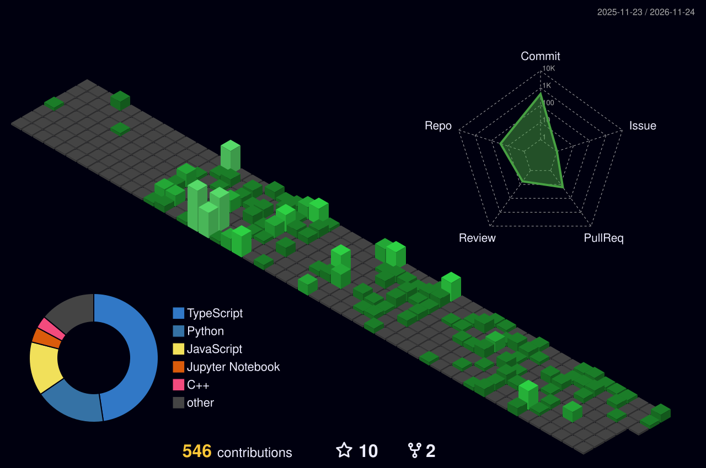
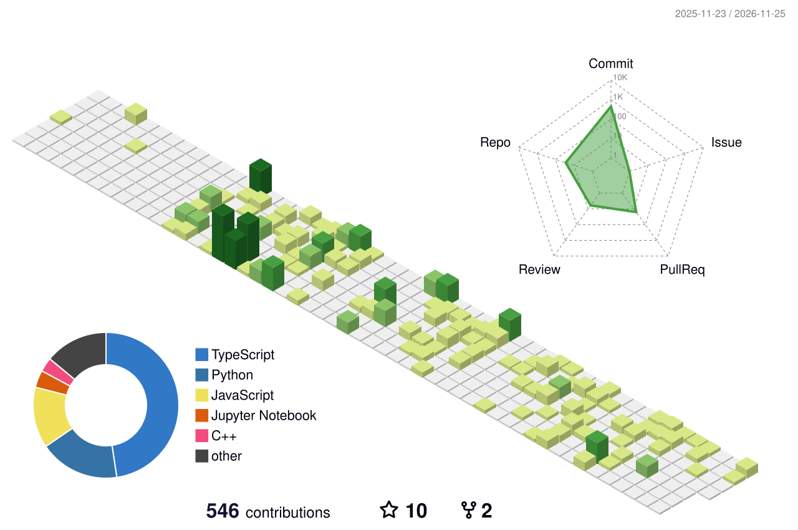

<!-- ① HEADER BANNER — clean gradient, no cheesy waving animation -->

  

<!-- ② TYPING HEADLINE — one sharp line, not four rotating buzzwords -->

 

<!-- ③ PORTFOLIO LINK — first thing, impossible to miss -->
### 🔗 [shreyansjaiswal.me](https://www.shreyansjaiswal.me/) &nbsp;·&nbsp; [shreyans.jaiswal704@gmail.com](mailto:shreyans.jaiswal704@gmail.com)

<!-- ④ QUICK-SCAN BADGES — role, school, status -->

---
Actively looking for a 6-month full-time Software Engineering internship for Jan-Jun 2027, preferably with a PPO, followed by full-time work from Jun-Jul 2027.

I'm a final-year B.Tech IT student at NIT Jalandhar, graduating in June 2027. I'm interested in backend, full-stack, platform, and AI/ML roles where I can build real products and learn from a strong engineering team.

Open to opportunities in India first, and international roles with visa sponsorship. If you're hiring for Jan-Jun 2027, or you're a group of engineers building cool stuff, I'd love to connect.

---

## 💼 Experience

<table>
<tr>
<th></th>
<th align="left">Role</th>
<th align="left">Organization</th>
<th align="left">Impact & Stack</th>
</tr>

<tr>
<td>🟣</td>
<td>
<b>Salesforce Developer Intern</b> 
Jun – Aug (2026)
</td>
<td>
<b>Conscendo Technologies</b> 
  (Salesforce Summit Partner Company) 
Hyderabad, India
</td>
<td>
• Built 25+ CRM automation workflows using <b>Apex</b> & <b>Lightning</b> 
• Automated lead/case lifecycles via <b>Flows & Triggers</b> (~20% effort reduction) 
• Developed an <b>AI-powered Flow Generator</b> (LLM → Apex → Flow XML) 
• Worked with <b>Salesforce Data Cloud</b> for identity resolution & segmentation
</td>
</tr>

<tr>
<td>🔵</td>
<td>
<b>Software Developer Intern </b> 
Jun – Jul (2025)
</td>
<td>
<b>Engineers India Limited (EIL)</b> 
New Delhi, India
</td>
<td>
• Built & deployed a <b>MERN-based scholarship platform</b> serving 500+ users 
• Designed backend with <b>JWT auth</b> & scalable <b>REST APIs</b> 
• Implemented <b>Jest test suites</b> achieving 70%+ coverage 
• Streamlined application workflows (verification, role-based access, validation)
</td>
</tr>

</table>

  
  
## 🛠️ Tech Stack

<table>
<tr>
<td><b>Languages</b></td>
<td>
  

</td>
</tr>

<tr>
<td><b>AI & Systems</b></td>
<td>

</td>
</tr>

<tr>
<td><b>Backend & Infrastructure</b></td>
<td>

</td>
</tr>

<tr>
<td><b>Cloud & DevOps</b></td>
<td>

</td>
</tr>

<tr>
<td><b>Frontend</b></td>
<td>

</td>
</tr>
</table>

## 🚀 Projects

<table>
<tr>

<td width="50%" valign="top">

### [⚡ Live-CODE-X](https://live-code-x.netlify.app/)
Real-time collaborative IDE — **<50ms sync latency** for 20+ simultaneous users via WebSockets & Socket.IO. Integrated Judge0 API for multi-language in-browser execution. 85% Jest coverage on all core event handlers.

`WebSockets` `Socket.IO` `Judge0` `Jest`

[🔗 Live](https://live-code-x.netlify.app/) · [📁 Repo](https://github.com/Shreyans-704/LIVE-CODE-X)

</td>

<td width="50%" valign="top">

### [🎬 Narrately](https://narrately.in)
AI SaaS video platform — Gemini API script generation, **Redis async queues** (40% faster rendering), AWS S3 media storage. 100+ active users at <3s end-to-end latency.

`React` `Node.js` `Gemini API` `Redis` `AWS S3`

[🔗 Live](https://narrately.in) · [📁 Repo](https://github.com/Shreyans-704/Narrately-AI-)

</td>

</tr>

<tr>

<td width="50%" valign="top">

### [📡 Decentralized LAN File Sharing](https://github.com/Shreyans-704/decentralized-lan-file-sharing)
High-performance peer-to-peer file transfer system — custom TCP chunked protocol (~88 MB/s throughput), UDP broadcast-based peer discovery, fault-tolerant resume via chunk tracking, and SHA-256 end-to-end integrity verification.

`C++` `TCP/IP` `UDP` `Socket Programming` `SHA-256`

[📁 Repo](https://github.com/Shreyans-704/decentralized-lan-file-sharing)

</td>

<td width="50%" valign="top">

### [🏗️ Self-Healing Infrastructure](https://github.com/Shreyans-704/Self-Healing-Web-App-Infrastructure)
Production-grade infra that **automatically recovers from crashes** using Docker restart policies, Prometheus metrics, and Grafana dashboards. Failure scenarios simulated and validated through live system analysis.

`Docker` `Prometheus` `Grafana` `Linux`

[📁 Repo](https://github.com/Shreyans-704/Self-Healing-Web-App-Infrastructure)

</td>

</tr>

<tr>

<td width="50%" valign="top">

### [📞 Call2Kitchen](https://github.com/Shreyans-704/Call2Kitchen)
AI-powered restaurant phone ordering — Bolna voice agent takes orders in natural speech, backend **validates menu, prices and availability server-side** before confirming, then persists the order to a real-time kitchen dashboard.

`Bolna` `Express` `TypeScript` `Supabase` `Next.js`

[📁 Repo](https://github.com/Shreyans-704/Call2Kitchen)

</td>

<td width="50%" valign="top">

### [📈 First Step](https://first-step-groww.vercel.app/)
Independent educational prototype for first-time investors aged 20–26 — **Financial Readiness Assessment, Safe-Start Flex SIP with pause/resume, Growth Simulator and My Plan dashboard**, all simulated locally with no login or backend. Not an official Groww product.

`React 19` `TypeScript` `TanStack Start` `Tailwind CSS`

[🔗 Live](https://first-step-groww.vercel.app/) · [📁 Repo](https://github.com/Shreyans-704/FirstStepGROWW-)

</td>

</tr>
</table>

## 🌍 Open Source & Engineering Contributions

Contributing beyond personal projects through open-source projects and real-world engineering work.

| Organization | Contribution | Status |
|---|---|---|
| 🦊 **[Mozilla Firefox iOS](https://github.com/mozilla-mobile/firefox-ios/pull/35562)**   |Fix : Firefox briefly shows previous session before opening copied link from widget | ✅ Merged |
| 🧩 **[Unlayer — YC S22](https://github.com/unlayer/elements/pull/55)** | Contributed a code improvement to Unlayer's open-source Elements project. | ✅ Merged |
| ☁️ **[Conscendo Technologies](https://github.com/Conscendotechnologies/Siid-Code/pull/187)**| Fix: restore deleteMessageConfirm and editMessageConfirm message handlers | ✅ Merged |

**3 contributions successfully merged into external codebases.**

## 🏆 Achievements
 
<table> 
<tr> 
<th>Achievement</th> 
<th>Recognition</th> 
<th>Selection / Scale</th> 
</tr> 
 
<tr> 
<td><b>Amazon ML Summer School 2026</b></td> 
<td> 
<b>Completed</b> Amazon's selective ML program covering machine learning concepts and applications. 
</td> 
<td> 
<b>134,421 registered → 31,821 shortlisted → 3,000 selected</b> 
</td> 
</tr> 
 
<tr> 
<td><b>Flipkart GRID 8.0</b></td> 
<td> 
<b>Semifinalist</b> in Flipkart's national-level technology challenge. 
</td> 
<td> 
National-level competition
</td> 
</tr> 
 
<tr> 
<td><b>Axis Bank MOVES 2026</b></td> 
<td> 
Advanced to <b>Round 3</b> of <i>The Axis Banker</i> simulation; developed and pitched the <b>Axis Resilience Operating System (AROS)</b>.
</td> 
<td> 
Top <b>11.3%</b>
</td> 
</tr>
 
<tr> 
<td><b>McKinsey Career Forward Programme</b></td> 
<td> 
<b>Completed</b> a structured professional-development program focused on career readiness and professional skills. 
</td> 
<td> 
220K+ learners completed globally
</td> 
</tr> 

<tr> 
<td><b>Salesforce Trailhead</b></td> 
<td> 
Earned <b>30+ Trailhead Badges</b> across Salesforce development, automation, and Data Cloud; achieved the <b>Explorer</b> rank.
</td> 
<td> 
<b>30+ badges · Mountaineer</b>
</td> 
</tr>
 
<tr> 
<td><b>Google Cloud Skill Boost</b></td> 
<td> 
Earned <b>12+ Skill Badges</b> across GenAI, Cloud Run, Vision APIs, and other Google Cloud technologies. 
</td> 
<td> 
<b>Top 10 to complete the challenge in college</b>
</td> 
</tr> 
 
</table>

---

<!-- ⑦ STATS WIDGETS — all themed consistently, compact layout -->

## 📊 GitHub Stats

  

<!-- ⑪ 3D CONTRIBUTION CITY — generated daily by .github/workflows/profile-3d.yml -->
## 🏙️ Contribution City

  

<!-- To use the animated green version instead, swap the line above for:
  
-->

---

## 🌐 Connect

 

  

